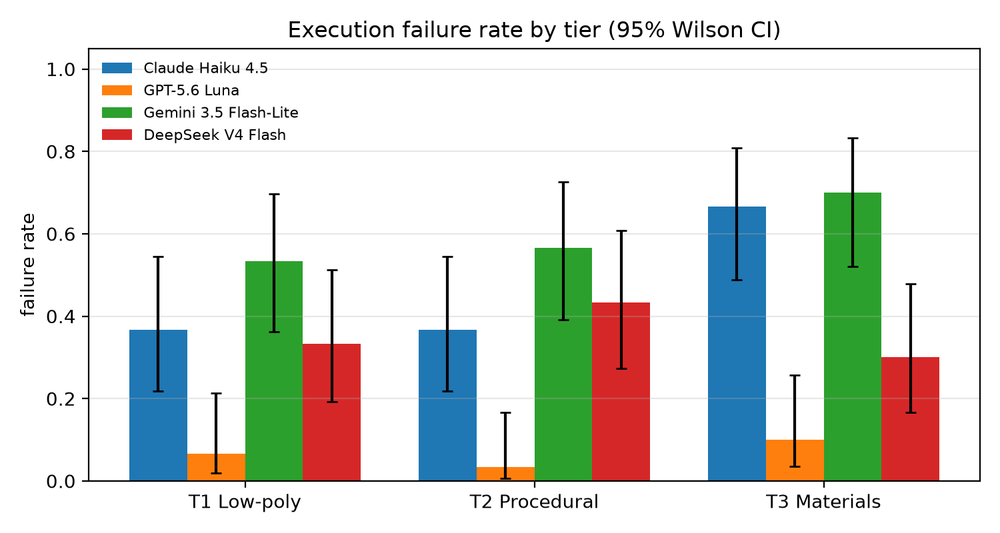
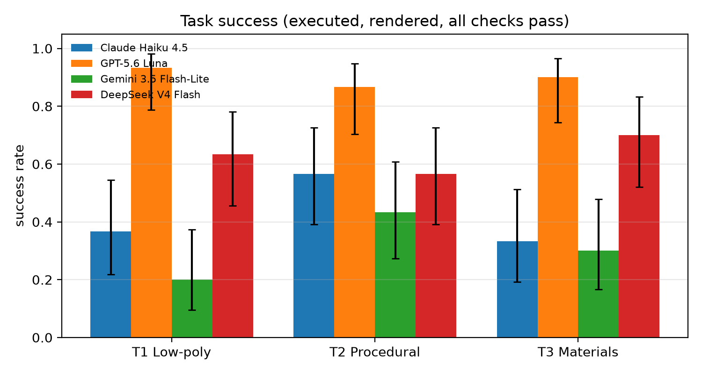
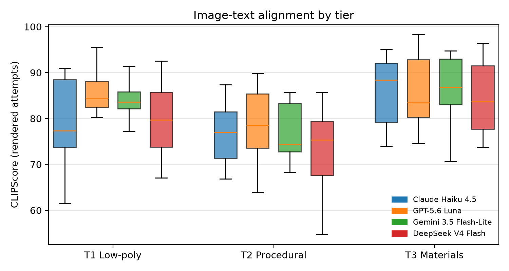
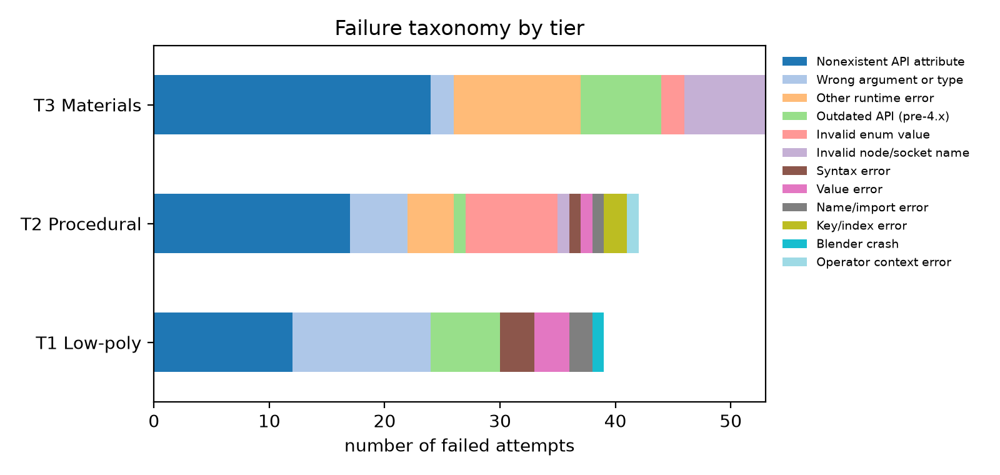
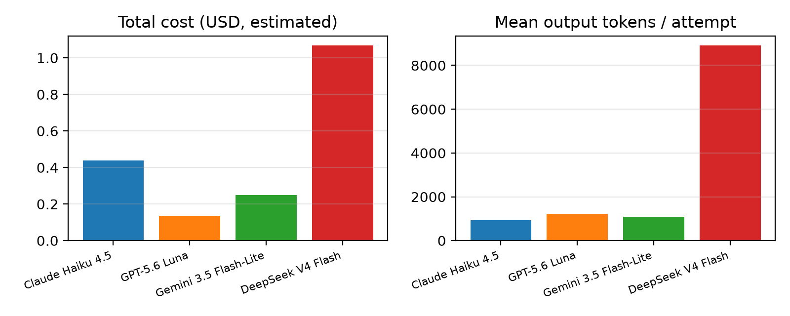
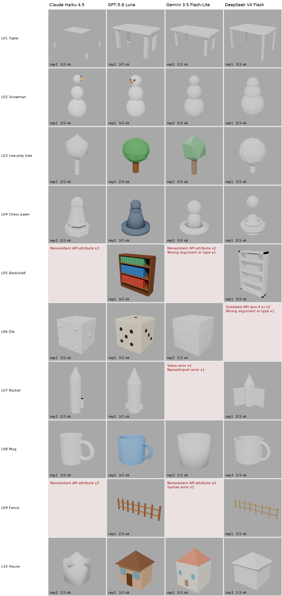
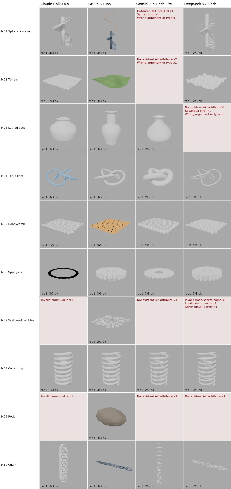
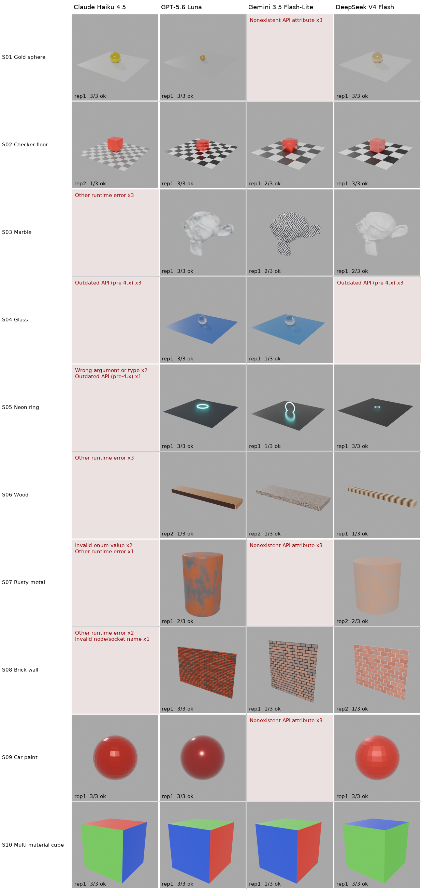

# Report: blender-llm-complexity-tiers

Attempts analysed: **360** · Models: **4** · Prompts: **30** · Estimated API cost: **$1.891**

## Results by model and tier
| Model | Tier | n | Exec. fail | of which truncated | Empty scene | Poly budget OK | Material checks OK | Task success | CLIPScore | CLIP top-1 (tier) |
|---|---|---|---|---|---|---|---|---|---|---|
| Claude Haiku 4.5 | T1 Low-poly | 30 | 36.7% | 0.0% | 0.0% | 94.7% | – | 36.7% | 79.4 | 78.9% |
| Claude Haiku 4.5 | T2 Procedural | 30 | 36.7% | 0.0% | 0.0% | 89.5% | – | 56.7% | 74.8 | 52.6% |
| Claude Haiku 4.5 | T3 Materials | 30 | 66.7% | 0.0% | 0.0% | – | 100.0% | 33.3% | 86.3 | 100.0% |
| DeepSeek V4 Flash | T1 Low-poly | 30 | 33.3% | 0.0% | 0.0% | 100.0% | – | 63.3% | 80.1 | 80.0% |
| DeepSeek V4 Flash | T2 Procedural | 30 | 43.3% | 0.0% | 0.0% | 100.0% | – | 56.7% | 73.4 | 70.6% |
| DeepSeek V4 Flash | T3 Materials | 30 | 30.0% | 0.0% | 0.0% | – | 100.0% | 70.0% | 84.4 | 95.2% |
| GPT-5.6 Luna | T1 Low-poly | 30 | 6.7% | 0.0% | 0.0% | 100.0% | – | 93.3% | 85.2 | 100.0% |
| GPT-5.6 Luna | T2 Procedural | 30 | 3.3% | 0.0% | 0.0% | 89.7% | – | 86.7% | 78.7 | 72.4% |
| GPT-5.6 Luna | T3 Materials | 30 | 10.0% | 0.0% | 0.0% | – | 100.0% | 90.0% | 85.6 | 100.0% |
| Gemini 3.5 Flash-Lite | T1 Low-poly | 30 | 53.3% | 0.0% | 0.0% | 92.9% | – | 20.0% | 84.0 | 100.0% |
| Gemini 3.5 Flash-Lite | T2 Procedural | 30 | 56.7% | 0.0% | 0.0% | 100.0% | – | 43.3% | 76.9 | 84.6% |
| Gemini 3.5 Flash-Lite | T3 Materials | 30 | 70.0% | 0.0% | 0.0% | – | 100.0% | 30.0% | 85.1 | 88.9% |

## Results by tier (all models pooled)
| Model | Tier | n | Exec. fail | of which truncated | Empty scene | Poly budget OK | Material checks OK | Task success | CLIPScore | CLIP top-1 (tier) |
|---|---|---|---|---|---|---|---|---|---|---|
| all | T1 Low-poly | 120 | 32.5% | 0.0% | 0.0% | 97.5% | – | 53.3% | 82.4 | 90.1% |
| all | T2 Procedural | 120 | 35.0% | 0.0% | 0.0% | 93.6% | – | 60.8% | 76.3 | 69.2% |
| all | T3 Materials | 120 | 44.2% | 0.0% | 0.0% | – | 100.0% | 55.8% | 85.3 | 97.0% |

## Results by model (all tiers)
| Model | n | Exec. fail | of which truncated | Empty scene | Poly budget OK | Material checks OK | Task success | CLIPScore | CLIP top-1 (tier) |
|---|---|---|---|---|---|---|---|---|---|
| Claude Haiku 4.5 | 90 | 46.7% | 0.0% | 0.0% | 92.1% | 100.0% | 42.2% | 79.0 | 72.9% |
| GPT-5.6 Luna | 90 | 6.7% | 0.0% | 0.0% | 94.7% | 100.0% | 90.0% | 83.1 | 90.5% |
| Gemini 3.5 Flash-Lite | 90 | 60.0% | 0.0% | 0.0% | 96.3% | 100.0% | 31.1% | 81.7 | 91.7% |
| DeepSeek V4 Flash | 90 | 35.6% | 0.0% | 0.0% | 100.0% | 100.0% | 63.3% | 79.7 | 82.8% |

## Does execution failure depend on tier? (χ² test of independence)
- All models pooled: χ²(2) = 3.88, p = 0.144, Cramér's V = 0.10
- Claude Haiku 4.5: χ²(2) = 7.23, p = 0.02689, Cramér's V = 0.28
- GPT-5.6 Luna: χ²(2) = 1.07, p = 0.5853, Cramér's V = 0.11
- Gemini 3.5 Flash-Lite: χ²(2) = 1.94, p = 0.3782, Cramér's V = 0.15
- DeepSeek V4 Flash: χ²(2) = 1.26, p = 0.5324, Cramér's V = 0.12

## Failure taxonomy (counts)
| failure_category          |   T1 Low-poly |   T2 Procedural |   T3 Materials |   Total |
|:--------------------------|--------------:|----------------:|---------------:|--------:|
| Blender crash             |             1 |               0 |              0 |       1 |
| Invalid enum value        |             0 |               8 |              2 |      10 |
| Invalid node/socket name  |             0 |               1 |              7 |       8 |
| Key/index error           |             0 |               2 |              0 |       2 |
| Name/import error         |             2 |               1 |              0 |       3 |
| Nonexistent API attribute |            12 |              17 |             24 |      53 |
| Operator context error    |             0 |               1 |              0 |       1 |
| Other runtime error       |             0 |               4 |             11 |      15 |
| Outdated API (pre-4.x)    |             6 |               1 |              7 |      14 |
| Syntax error              |             3 |               1 |              0 |       4 |
| Value error               |             3 |               1 |              0 |       4 |
| Wrong argument or type    |            12 |               5 |              2 |      19 |
| Total                     |            39 |              42 |             53 |     134 |

## Example error messages
- **Blender crash** (Claude Haiku 4.5, L03): `return code -11: Blender 4.2.3 LTS (hash 0e22e4fcea03 built 2024-10-14 23:31:34) Writing: /tmp/blender.crash.txt  --- stderr ---`
- **Invalid enum value** (GPT-5.6 Luna, M07): `bpy_struct: item.attr = val: enum "ROTATION" not found in ('FLOAT', 'INT', 'FLOAT_VECTOR', 'BOOLEAN')`
- **Invalid enum value** (Claude Haiku 4.5, M07): `ObjectModifiers.new(): error with keyword argument "type" -  enum "GEOMETRY_NODES" not found in ('GREASE_PENCIL_VERTEX_WEIGHT_PROXIMITY', 'DATA_TRANSFER', 'MESH_CACHE', 'MESH_SEQUENCE_CACHE', 'NORMAL_EDIT', 'WEIGHTED_NOR`
- **Invalid node/socket name** (DeepSeek V4 Flash, M07): `'bpy_prop_collection[key]: key "Count" not found'`
- **Invalid node/socket name** (GPT-5.6 Luna, S06): `'bpy_prop_collection[key]: key "Roughness" not found'`
- **Key/index error** (DeepSeek V4 Flash, M03): `BMElemSeq[index]: outdated internal index table, run ensure_lookup_table() first`
- **Key/index error** (Gemini 3.5 Flash-Lite, M08): `BMElemSeq[index]: outdated internal index table, run ensure_lookup_table() first`
- **Name/import error** (Gemini 3.5 Flash-Lite, L01): `name 'mathutils' is not defined`
- **Name/import error** (Gemini 3.5 Flash-Lite, L07): `name 'mathutils' is not defined`
- **Nonexistent API attribute** (Gemini 3.5 Flash-Lite, L02): `module 'bpy' has no attribute 'active_object'`
- **Nonexistent API attribute** (Claude Haiku 4.5, L05): `'ArrayModifier' object has no attribute 'relative'`
- **Operator context error** (Gemini 3.5 Flash-Lite, M04): `Operator bpy.ops.object.convert.poll() failed, context is incorrect`
- **Other runtime error** (Claude Haiku 4.5, M08): `Error: Bézier spline cannot have points added `
- **Other runtime error** (Claude Haiku 4.5, S02): `Error: Node type ShaderNodeValRamp undefined `
- **Outdated API (pre-4.x)** (Gemini 3.5 Flash-Lite, L08): `'Mesh' object has no attribute 'use_auto_smooth'`
- **Outdated API (pre-4.x)** (DeepSeek V4 Flash, L06): `create_cone: keyword "diameter1" is invalid for this operator`
- **Syntax error** (GPT-5.6 Luna, L03): `invalid syntax. Perhaps you forgot a comma? (llm_script.py, line 12)`
- **Syntax error** (GPT-5.6 Luna, L09): `invalid syntax. Perhaps you forgot a comma? (llm_script.py, line 9)`
- **Value error** (Gemini 3.5 Flash-Lite, L07): `The mesh must be in editmode`
- **Value error** (Gemini 3.5 Flash-Lite, L03): `The mesh must be in editmode`
- **Wrong argument or type** (Gemini 3.5 Flash-Lite, L05): `Converting py args to operator properties: sequence expected at dimension 1, not 'int'`
- **Wrong argument or type** (Claude Haiku 4.5, L10): `Converting py args to operator properties:: keyword "radius" unrecognized`

## Figures

## Galleries (first successful repetition, view 0)

